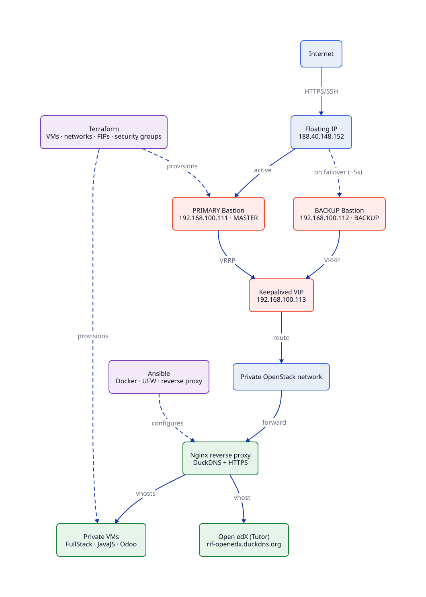
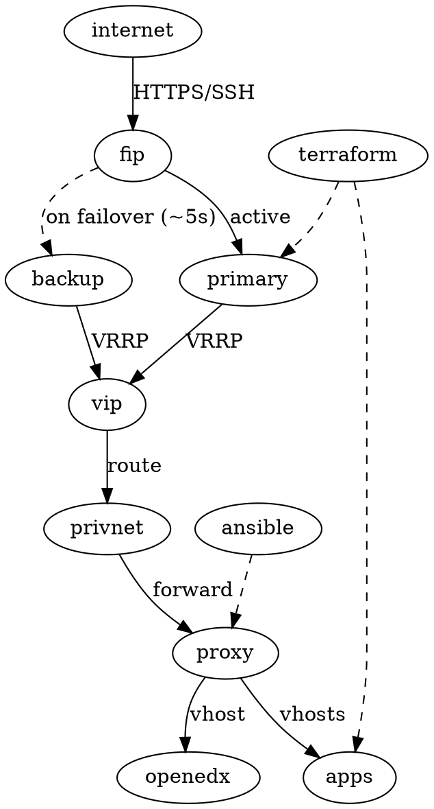

# OpenStack HA Bastion Infrastructure

<p>
  
  
  
  
  
</p>

> DevOps internship build: Terraform provisioning and Ansible configuration of
> Open edX on OpenStack, fronted by an HA Bastion on a single Floating IP with
> validated PRIMARY→BACKUP failover in ~5s, served via Nginx/DuckDNS/HTTPS.

## 1. Project Overview

This project aims to improve, secure, and automate a private **OpenStack Cloud infrastructure** using **Terraform**, **Ansible**, and a **High Availability Bastion architecture**.

The main objectives are:

* Centralize SSH access through a **Bastion Host**
* Reduce the number of public **Floating IPs**
* Provide **High Availability (HA)** for the Bastion
* Automatically fail over to a Backup Bastion when the Primary Bastion becomes unavailable
* Deploy new private VMs using **Terraform**
* Access private VMs through the Bastion
* Automate server configuration and application deployment using **Ansible**
* Expose applications through an **Nginx Reverse Proxy**
* Manage application domain names using **DuckDNS**
* Secure applications using **HTTPS / Let's Encrypt**

---

## 2. Architecture Overview



*One Floating IP fronts a Keepalived PRIMARY/BACKUP Bastion pair. Terraform
provisions the infrastructure, Ansible configures it, and Nginx exposes private
VMs (including Open edX) via DuckDNS/HTTPS.*

<details>
<summary><b>Diagram sources (D2 · Graphviz)</b></summary>

- [`docs/architecture.d2`](docs/architecture.d2) — render with `d2 docs/architecture.d2 docs/architecture.svg`
- [`docs/architecture.dot`](docs/architecture.dot) — render with `dot -Tsvg docs/architecture.dot -o docs/architecture-gv.svg`

```d2
direction: down

internet: "Internet"
fip: "Floating IP\n<FLOATING_IP>"
primary: "PRIMARY Bastion\n192.168.100.111 · MASTER"
backup: "BACKUP Bastion\n192.168.100.112 · BACKUP"
vip: "Keepalived VIP\n192.168.100.113"
privnet: "Private OpenStack network"
proxy: "Nginx reverse proxy\nDuckDNS + HTTPS"
openedx: "Open edX (Tutor)\nrif-openedx.duckdns.org"
apps: "Private VMs\nFullStack · JavaJS · Odoo"
terraform: "Terraform\nVMs · networks · FIPs · security groups"
ansible: "Ansible\nDocker · UFW · reverse proxy"

internet -> fip: HTTPS/SSH
fip -> primary: active
fip -> backup: on failover (~5s)
primary -> vip: VRRP
backup -> vip: VRRP
vip -> privnet: route
privnet -> proxy: forward
proxy -> openedx: vhost
proxy -> apps: vhosts
terraform -> primary: provisions
terraform -> apps: provisions
ansible -> proxy: configures
```



</details>

The infrastructure uses two Bastion servers:

```text
                         Internet
                            |
                            |
                    Public Floating IP
                     <FLOATING_IP>
                            |
                            v
                    +---------------+
                    |  Bastion HA   |
                    +---------------+
                       /         \
                      /           \
                     v             v
              PRIMARY Bastion   BACKUP Bastion
              192.168.100.111   192.168.100.112
                     \             /
                      \           /
                       +---------+
                            |
                       Keepalived
                            |
                    VIP: 192.168.100.113
                            |
                            v
                 Private OpenStack Network
                            |
             +--------------+--------------+
             |              |              |
             v              v              v
          Private VM     Private VM     Private VM
```

Instead of assigning a public Floating IP to every virtual machine, the infrastructure uses a **single public Floating IP** as the main entry point.

---

## 3. Bastion Host

The Bastion Host provides a centralized and controlled entry point to private virtual machines.

Users first connect to the Bastion:

```bash
ssh ubuntu@<FLOATING_IP>
```

Private VMs can then be reached through the Bastion.

For example, SSH `ProxyJump` can be used:

```bash
ssh -J ubuntu@<FLOATING_IP> ubuntu@PRIVATE_VM_IP
```

This architecture prevents private VMs from requiring their own public Floating IPs.

### Benefits

* Fewer public Floating IPs
* Centralized SSH access
* Reduced attack surface
* Easier access management
* Private VMs remain isolated from direct Internet access

---

## 4. High Availability Bastion

A single Bastion would create a **Single Point of Failure (SPOF)**.

To solve this issue, a second Bastion was deployed.

| Role          | Instance               | IP Address        |
| ------------- | ---------------------- | ----------------- |
| Primary       | `bastion-nawel-test`   | `192.168.100.111` |
| Backup        | `bastion-nawel-backup` | `192.168.100.112` |
| Virtual IP    | Keepalived VIP         | `192.168.100.113` |
| Public Access | Floating IP            | `<FLOATING_IP>`  |

---

## 5. Keepalived and Failover

**Keepalived** is used to manage the HA state between the two Bastion servers.

Under normal conditions:

```text
<FLOATING_IP>
       |
       v
192.168.100.111
PRIMARY Bastion
    MASTER
       |
       |
192.168.100.112
BACKUP Bastion
    BACKUP
```

The Primary Bastion handles the public access while the Backup Bastion remains ready to take over.

---

## 6. Automatic Failover

If the Primary Bastion becomes unavailable:

```text
PRIMARY
192.168.100.111
      X
      |
      | Failure detected
      |
      v
BACKUP
192.168.100.112
      |
      | Becomes MASTER
      |
      v
Floating IP
<FLOATING_IP>
```

The Backup Bastion automatically becomes `MASTER`.

The public Floating IP is moved to:

```text
192.168.100.112
```

Users can continue using the same public IP:

```bash
ssh ubuntu@<FLOATING_IP>
```

Therefore, users do not need to know which Bastion is currently active.

---

## 7. Automatic Failback

When the Primary Bastion becomes operational again, it recovers its `MASTER` role.

The Floating IP is reassociated with:

```text
192.168.100.111
```

The infrastructure automatically returns to its normal state.

---

## 8. HA Verification

The current Floating IP association can be checked from the OpenStack Controller:

```bash
openstack floating ip show <FLOATING_IP> \
  -c floating_ip_address \
  -c fixed_ip_address \
  -c port_id \
  -c status
```

Check the Primary Bastion:

```bash
hostname
ip -br addr
sudo systemctl status keepalived --no-pager
```

Check the Backup Bastion:

```bash
hostname
ip -br addr
sudo systemctl status keepalived --no-pager
```

Finally, test SSH access:

```bash
ssh ubuntu@<FLOATING_IP>
```

---

# Terraform Automation

## 9. Infrastructure as Code

**Terraform** is used to automate OpenStack resource provisioning.

Terraform manages resources such as:

```text
openstack_compute_instance_v2
openstack_networking_port_v2
openstack_networking_secgroup_v2
openstack_blockstorage_volume_v3
openstack_compute_volume_attach_v2
openstack_compute_keypair_v2
```

This allows infrastructure resources to be created in a reproducible way.

---

## 10. Deploying a New VM Behind the Bastion

A Terraform configuration was created to deploy new VMs directly behind the Bastion.

Example:

```text
Terraform
    |
    v
OpenStack
    |
    v
new-vm-via-bastion
    |
    +---- Private IP
    |
    +---- Network Port
    |
    +---- Security Group
    |
    +---- SSH Keypair
    |
    +---- Volume
    |
    +---- No individual Floating IP
```

The new VM is connected to the private OpenStack network.

It does **not** require its own Floating IP.

---

## 11. Terraform Workflow

The basic Terraform workflow is:

```bash
terraform init
```

Check the configuration:

```bash
terraform validate
```

Preview infrastructure changes:

```bash
terraform plan
```

Deploy the infrastructure:

```bash
terraform apply
```

Check the Terraform state:

```bash
terraform state list
```

---

## 12. Security Groups

OpenStack Security Groups are used to control access between the Bastion and private VMs.

The expected access flow is:

```text
Internet
   |
   v
Floating IP
   |
   v
Bastion HA
   |
   | SSH
   v
Security Group
   |
   v
Private VM
```

Private VMs can therefore restrict SSH access to traffic coming from the Bastion infrastructure.

For existing VMs, migration can be performed progressively.

During the migration phase, the existing Security Groups can be preserved while the new Bastion Security Group is added.

```text
Existing VM
    |
    +---- Existing Security Group
    |
    +---- Bastion Security Group
               |
               v
           Access Test
               |
               v
           Validation
               |
               v
       Remove unnecessary
        public access later
```

This approach reduces the risk of losing access during migration.

---

# Ansible Automation

## 13. Configuration Management

After Terraform provisions the infrastructure, **Ansible** is used for server configuration and application deployment.

The responsibilities are separated as follows:

```text
Terraform
    |
    | Infrastructure provisioning
    v
OpenStack
    |
    | VM created
    v
Ansible
    |
    | Server configuration
    v
Docker / Nginx / Applications
```

### Terraform

Responsible for:

* VM creation
* Network ports
* Security Groups
* Volumes
* SSH keys
* OpenStack resources

### Ansible

Responsible for:

* Server configuration
* Package installation
* Docker installation/configuration
* Application deployment
* Nginx configuration
* Reverse Proxy configuration
* DuckDNS configuration
* HTTPS configuration
* Firewall configuration

---

## 14. Nginx Reverse Proxy

**Nginx** is installed on the Bastion and acts as a Reverse Proxy.

Incoming HTTP/HTTPS requests are forwarded to applications hosted on private VMs.

Example:

```text
User
 |
 | HTTPS
 v
rif-fullstack.duckdns.org
 |
 v
DuckDNS
 |
 v
<FLOATING_IP>
Floating IP
 |
 v
Bastion HA
 |
 v
Nginx Reverse Proxy
 |
 v
192.168.100.87:80
 |
 v
Full Stack Application
```

The application server therefore remains on a private OpenStack IP address.

---

## 15. DuckDNS

**DuckDNS** is used to provide domain names for applications.

Current examples include:

| Domain                      | Private Backend       |
| --------------------------- | --------------------- |
| `rif-fullstack.duckdns.org` | `192.168.100.87:80`   |
| `rif-javajs.duckdns.org`    | `192.168.100.149:80`  |
| `rif-openedx.duckdns.org`   | `192.168.100.55:80`   |
| `rif-odoo.duckdns.org`      | `192.168.100.91:8090` |

The request flow is:

```text
Application Domain
       |
       v
    DuckDNS
       |
       v
Public Floating IP
       |
       v
Bastion HA
       |
       v
Nginx Reverse Proxy
       |
       v
Private Application VM
```

---

## 16. HTTPS with Let's Encrypt

Application access is secured using **Let's Encrypt** certificates.

**Certbot** is used to obtain and manage the SSL certificates.

```text
DuckDNS Domain
      |
      v
   Certbot
      |
      v
Let's Encrypt
      |
      v
SSL Certificate
      |
      v
    Nginx
      |
      v
    HTTPS
```

Applications can therefore be accessed using HTTPS:

```text
https://rif-fullstack.duckdns.org
https://rif-javajs.duckdns.org
https://rif-openedx.duckdns.org
https://rif-odoo.duckdns.org
```

---

## 17. Ansible Reverse Proxy Automation

The Ansible Reverse Proxy role automates:

* Nginx installation
* Nginx Reverse Proxy configuration
* DuckDNS configuration
* Certbot installation
* Let's Encrypt certificate management
* HTTPS configuration
* Firewall configuration
* Nginx configuration validation
* Nginx service reload

Example project structure:

```text
ansible/
├── inventory/
├── group_vars/
│   └── bastion.yml
│
├── roles/
│   ├── common/
│   ├── docker/
│   └── reverse_proxy/
│       ├── tasks/
│       ├── templates/
│       ├── handlers/
│       └── defaults/
│
└── playbooks/
```

---

# Complete Workflow

## 18. Terraform + OpenStack + Ansible

The complete deployment workflow is:

```text
                    Terraform
                        |
                        v
               OpenStack Resources
                        |
              +---------+---------+
              |                   |
              v                   v
          Bastion HA          Private VM
                                  |
                                  v
                               Ansible
                                  |
                    +-------------+-------------+
                    |             |             |
                    v             v             v
                  Docker        Nginx       Application
                                  |
                                  v
                               DuckDNS
                                  |
                                  v
                           Let's Encrypt
                                  |
                                  v
                                HTTPS
```

---

# Current Project Status

## 19. Completed Work

The following features have been implemented and tested:

* [x] Central Bastion Host deployment
* [x] SSH access through the Bastion
* [x] Private VM access through the Bastion
* [x] Reduction of individual Floating IP usage
* [x] Backup Bastion deployment
* [x] Keepalived configuration
* [x] Virtual IP configuration
* [x] Primary/Backup HA architecture
* [x] Automatic Floating IP reassociation
* [x] Primary → Backup failover test
* [x] Backup → Primary failback test
* [x] Terraform infrastructure automation
* [x] New private VM deployment using Terraform
* [x] VM deployment without an individual Floating IP
* [x] Security Group configuration
* [x] Ansible configuration automation
* [x] Nginx Reverse Proxy
* [x] DuckDNS integration
* [x] HTTPS with Let's Encrypt / Certbot
* [x] Application access through private backend IPs

---

## 20. Current Architecture

```text
                              INTERNET
                                  |
                                  v
                         <FLOATING_IP>
                          Floating IP
                                  |
                                  v
                        +----------------+
                        |   BASTION HA   |
                        +----------------+
                           /          \
                          /            \
                         v              v
                 PRIMARY .111       BACKUP .112
                         \              /
                          \            /
                           +----------+
                                |
                           Keepalived
                                |
                           VIP .113
                                |
                 +--------------+--------------+
                 |                             |
                 v                             v
           SSH Access                   Nginx Reverse Proxy
                 |                             |
                 v                             v
           Private VMs                      DuckDNS
                                               |
                                               v
                                      HTTPS / Let's Encrypt
                                               |
                       +-----------------------+----------------+
                       |              |             |           |
                       v              v             v           v
                  Full Stack       Java JS       OpenEdX       Odoo
                  .87:80          .149:80        .55:80      .91:8090
```

---

## 21. Technologies

The project currently uses:

* OpenStack
* Terraform
* Ansible
* Keepalived
* Nginx
* Docker
* DuckDNS
* Let's Encrypt
* Certbot
* Ubuntu Linux
* Git
* GitHub

---

## 22. Project Goal

The final objective is to provide an OpenStack infrastructure that is:

* **Automated**
* **Highly Available**
* **Centralized**
* **Secure**
* **Scalable**
* **Easy to manage**

The HA Bastion provides a centralized entry point, **Terraform** manages infrastructure provisioning, and **Ansible** manages configuration and application deployment.

```text
Infrastructure as Code
        +
Configuration as Code
        +
High Availability
        +
Centralized Access
        =
Automated OpenStack Infrastructure
```
